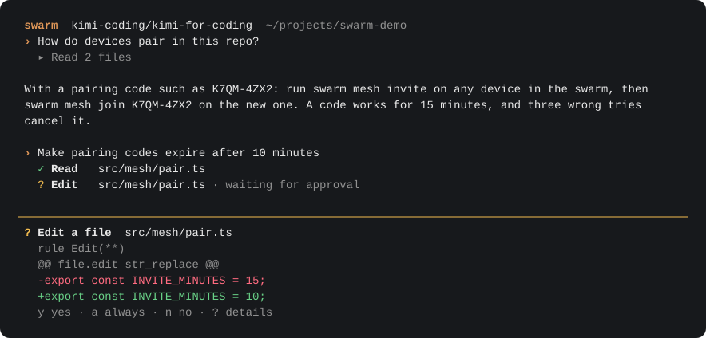
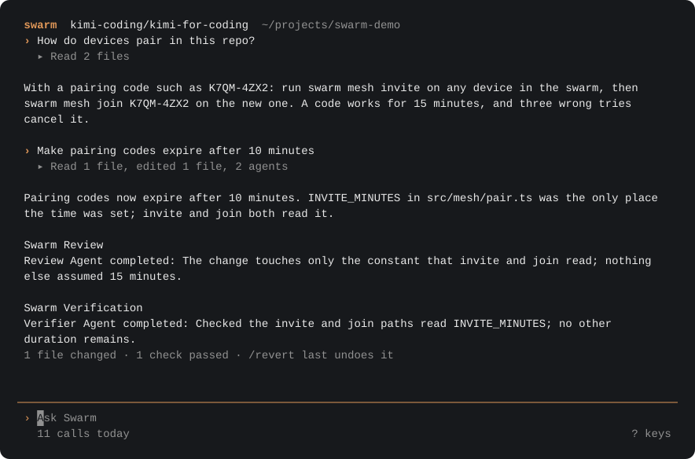
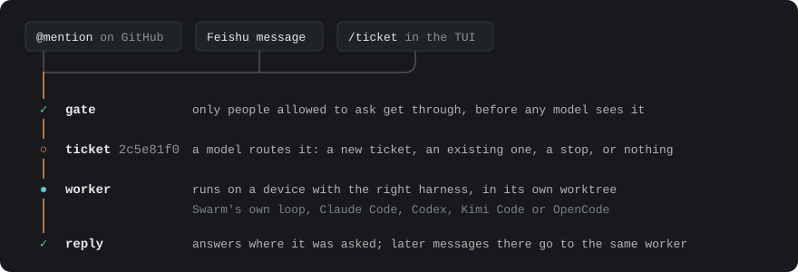
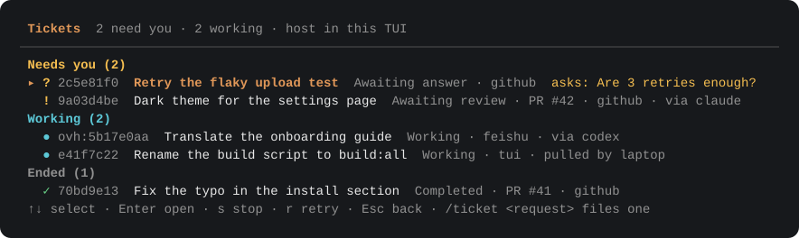
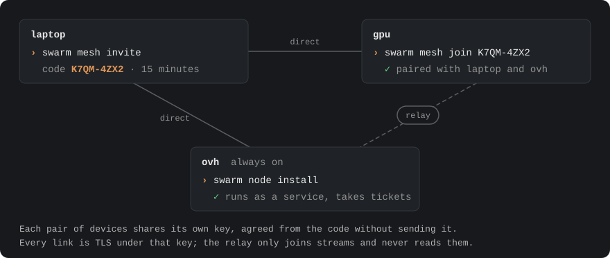

<picture>
  <source media="(prefers-color-scheme: dark)" srcset="docs/images/banner-dark.svg">
  
</picture>

A coding agent for your terminal that also takes your team's requests as tickets and runs them on your own devices.

[](https://github.com/Last-emo-boy/Swarm/actions/workflows/ci.yml)
[](LICENSE)
[](https://nodejs.org/)

English · [简体中文](README.zh-CN.md)



<sub>Rendered from the real app with a scripted model (<code>npm run docs:images</code>).</sub>

## What it does

- **Works in your repository.** It reads, edits, runs your tests and builds, and checks its own change before it says
  it is done.
- **Asks before risky steps.** Edits, commands and installs wait on a short card with the diff; you answer `y`, `a`
  or `n`.
- **Remembers where it stopped.** `/continue` picks a session up again, and what it remembers is checked against the
  files as they are now.
- **Takes tickets.** People ask on GitHub, in Feishu or with `/ticket`; each request gets its own worker and
  directory, in a VM of its own if you like, and the answer goes back where it was asked.
- **Works as a member of your team chat.** On Feishu it knows who is who, follows the conversation, messages and @s
  people for you, remembers what matters, and brings back the answers to what it asked for you.
- **Uses the agents you already have.** A ticket or a subagent can run on Claude Code, Codex, Kimi Code or OpenCode
  instead of Swarm's own loop.
- **Links your devices.** A laptop, a server and a GPU box pair with a short code, and work goes to the one that has
  what it needs.

## Install

Swarm needs Node.js 24 or newer.

```bash
git clone https://github.com/Last-emo-boy/Swarm.git
cd Swarm
npm install
npm run build
npm install -g .
swarm onboard   # choose a provider and model, and enter its API key
swarm           # open Swarm in the current directory
```

`swarm update` later pulls, rebuilds and restarts this device's node service; `swarm update --check` only looks.
Setting models by hand, and running without the TUI, are in the guide's
[install and configure](docs/GUIDE.md#install-and-configure).

## A first session

1. Run `swarm` in a project.
2. Ask a question about it, or for a change, in your own words.
3. When an edit or a command needs your approval, the card says what and why: `y` allows it once, `a` for the rest of
   the session, `n` refuses, `?` shows everything the request carries.
4. Read the answer. The line under it says what changed and which checks passed, and `/revert last` undoes it.



| Key | What it does |
| --- | --- |
| `?` | Lists every key, on an empty prompt. |
| `Esc` | Moves from an empty prompt to the transcript; Esc or typing goes back. |
| `↑` `↓` then `Enter` | Picks a row in the transcript and folds or unfolds it. |
| `Ctrl+O` | Opens the latest detail, or the selected row's. |
| `Ctrl+F` | Searches the transcript. |
| `Ctrl+C` | Interrupts a run, or quits when nothing runs. |
| `/` | Starts a command; `/help` lists them. |

`swarm run "summarize this repository"` does one request without the TUI, with `--json` and `--stream-json` output
for scripts ([CLI](docs/GUIDE.md#cli)).

## Tickets

`swarm superagent` turns requests into tickets. Someone mentions the agent on GitHub, messages its Feishu bot in a
direct message or any group it is in, or types `/ticket <request>` in the TUI. A fixed check of who sent it runs before
any model sees the request; then each ticket gets a worker in its own directory, usually a git worktree, and the answer
goes back to the conversation it came from.



```bash
swarm superagent config init      # write ~/.swarm/superagent/settings.json
swarm superagent run              # run the host: sources, routing, workers, replies
swarm superagent request "fix the typo in README"
swarm superagent tickets          # what waits for a person comes first
```

`/tickets` in the TUI shows the same list, what needs you first:



GitHub and Feishu stay off until they are set up with an agent account and a bot. More in
[tickets](docs/GUIDE.md#tickets).

- **Who may ask, and for what.** With an `access` block, each person has a role, `owner`, `maintainer` or `everyone`,
  that sets what their work may do and how much they may ask. Someone who links their GitHub account with `/link` gets
  their work pushed and their pull requests opened on their own repositories, as themselves; other work comes back as a
  patch. See [roles and bot commands](docs/GUIDE.md#roles-and-bot-commands) and [access](docs/SUPERAGENT.md#access).
- **Where workers run.** By default each worker is a process of your OS user. With `executor.isolation: "vm"` each ticket
  gets a VM of its own that reaches nothing on the host but its gateway, on this host or in a Kubernetes cluster once
  the host's are busy. See [ticket VMs](docs/SUPERAGENT.md#ticket-vms).

### In your team chat

The Feishu bot hears every group it is in and answers when someone @s it. It reads who is who and the conversation
around a message, and it can message or @ people for you ("帮我私聊小王…"), wait for their answer, a person's or another
bot's, and bring it back. With `chatter.everywhere` it also joins in when a member would: a question nobody answered,
another bot that @s it, someone who calls it by name or replies to it. With `memory.enabled` it remembers people, chats
and itself across conversations and tickets, and keeps promises such as "两分钟后提醒我…"; `/memory` shows anyone what it
remembers about them and `/forget` erases it. See [conversation](docs/SUPERAGENT.md#conversation) and
[memory](docs/SUPERAGENT.md#memory).

### Workers on other agents

A ticket's worker, or a subagent the main Swarm delegates to, can run on an agent harness installed on the device:

| Harness | Profile | Checked with |
| --- | --- | --- |
| Claude Code | `claude` | `claude auth status` |
| Codex | `codex` | `codex login status` |
| Kimi Code | `kimi` | `kimi provider list` |
| OpenCode | `opencode` | `opencode auth list` |
| Claude Code on GLM | `claude-glm` | `ZHIPU_API_KEY` is set |
| Claude Code on DeepSeek | `claude-deepseek` | `DEEPSEEK_API_KEY` is set |

```bash
swarm harness check                                   # which harnesses can run here
swarm superagent request --harness claude "add a dark theme to the settings page"
```

Swarm's own permission rules do not reach inside another harness: it decides with its own mode, classifier or
sandbox. See [harness workers](docs/GUIDE.md#harness-workers) and [harness subagents](docs/GUIDE.md#harness-subagents).

## Mesh

Your devices link into one swarm. One device shows a pairing code, each new device joins with it, and every device
that joins is paired with every member. Paired devices' tickets show beside this one's, and a ticket's worker can run
on the device that has the harness or ability it needs (`gpu`, `macos`).



```bash
swarm mesh invite               # on any member: prints a code such as K7QM-4ZX2
swarm mesh join K7QM-4ZX2       # on the device to add
swarm node install              # keep this device's node up as a service
swarm mesh status               # every device: how it is reached, its abilities, its load
swarm mesh lend shell ~/work    # let paired devices run commands here, in this folder
```

A code works for 15 minutes, and three wrong tries cancel it. A paired device can act on this one's tickets, so pair
only devices you control. A device can lend the others a shell or file access in folders it names: Swarm sessions there
use them as tools, and so does every ticket's worker, through its host, from a ticket VM too. A lent shell runs as its
device's user, with that user's credentials. More in [mesh](docs/GUIDE.md#mesh).

## Usage and budgets

Every model call and harness turn is counted on the device that made it, with its provider, model and tokens.

```bash
swarm usage                          # the last 7 days on this device, by model
swarm usage --since 30d --by harness
swarm usage --by purpose             # the ticket host's own calls (routing, chatter, memory) apart from workers'
swarm usage --all-devices            # adds every paired device that answers
```

Caps per provider or harness, per day or month, in money or tokens, go in `usage.budgets`; once one is reached, new
calls on it stop with a message naming the setting that raises it. See
[usage, prices and budgets](docs/GUIDE.md#usage-prices-and-budgets).

## Automation

`swarm serve` starts a local HTTP and event-stream [Gateway](docs/GUIDE.md#local-gateway) for scripts and editors.
[Symphony](docs/GUIDE.md#symphony) reads work items from a repository's `WORKFLOW.md` and runs them in the background
through the same runner as the TUI.

## Documentation

- [Guide](docs/GUIDE.md): every command, the TUI, permissions, extensions, Gateway, Symphony, tickets, mesh and
  configuration.
- [Superagent](docs/SUPERAGENT.md): how the ticket host routes, assesses and runs work.
- [Capability plane](docs/EXTENSION_CAPABILITY_PLANE.md): tools, MCP, skills, commands, agent specs and plugins.
- [TUI product spec](docs/TUI_PRODUCT_SPEC.md) and [TUI renderer](docs/TUI_RENDERER.md).
- [Work Kernel](docs/WORK_KERNEL.md), [product requirements](docs/PRD.md) and the
  [Swarm v2 protocol RFC](docs/SWARM_V2_PROTOCOL_RFC.md).

## Status and boundaries

Release readiness is decided by the offline release gate (`npm run release:gate`), which passes without paid provider
calls; a claim counts as implemented only with a source anchor and a focused test. The full list is in the guide's
[product status](docs/GUIDE.md#product-status). What is deliberately bounded:

- A bounded Gateway checkpoint route lists, creates and reverts checkpoints for the server's workspace. Broader
  checkpoint orchestration remains deferred: no session- or run-scoped checkpoint API and no distributed checkpoint
  transport.
- Evidence-backed local Swarm v2 collaboration (actor identity, mailboxes, ownership leases, handoffs, the blackboard)
  is implemented and covered by local tests and evals.
- Broader distributed ASP transport is still planned: cross-host routing, a distributed worker model and distributed
  trace are not product claims.
- Cross-host distributed network execution of one run (the mesh places whole ticket workers on paired devices, not
  one plan's workers across hosts), complex consensus beyond the local protocol fixtures, and
  external provider dogfood remain deferred or optional.
- Hook-race approval arbitration and rich WorkSource writes remain deferred.

## Development

```bash
npm run check          # type-check
npm test               # unit and contract tests
npm run release:gate   # build and run the offline release gate
npm run docs:images    # render the terminal pictures in this README again
```

More in [development](docs/GUIDE.md#development).

## License

AGPL-3.0; see [LICENSE](LICENSE). `src/superagent/` includes code adapted from
[dsh-superagent-prototype](https://github.com/deepseek-ai/dsh-superagent-prototype) under the MIT License; see
[src/superagent/LICENSE.dsh-superagent](src/superagent/LICENSE.dsh-superagent).
