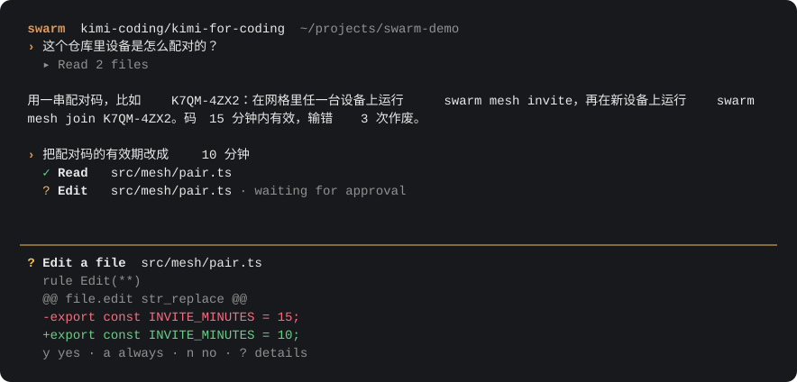
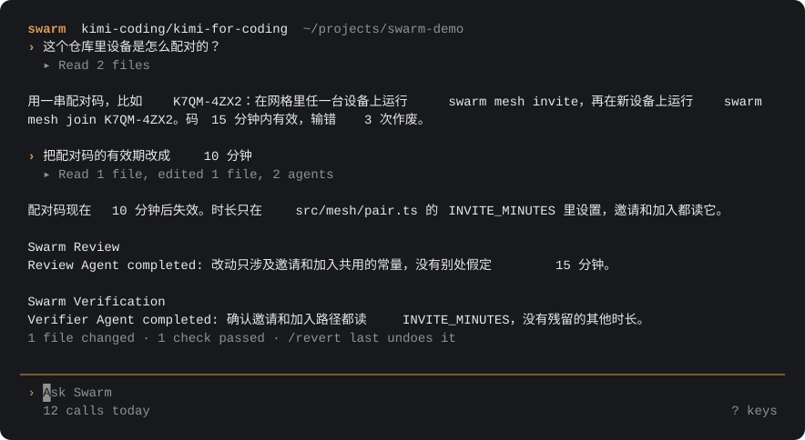
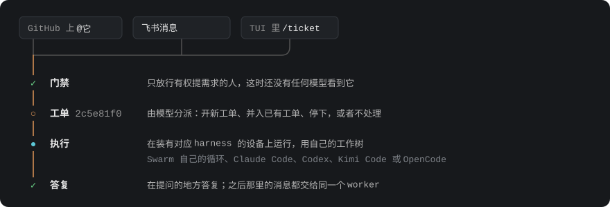
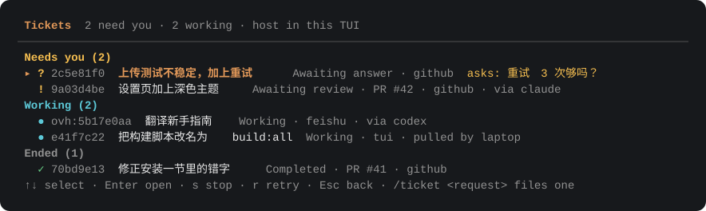
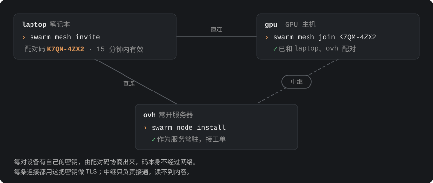

<picture>
  <source media="(prefers-color-scheme: dark)" srcset="docs/images/banner-dark.svg">
  
</picture>

一个在终端里写代码的 agent；它也能把团队的需求当作工单接下来，放到你自己的设备上去做。

[](https://github.com/Last-emo-boy/Swarm/actions/workflows/ci.yml)
[](LICENSE)
[](https://nodejs.org/)

[English](README.md) · 简体中文



<sub>由真实的应用配合脚本化的模型渲染（<code>npm run docs:images</code>）。</sub>

## 它能做什么

- **在你的仓库里干活。** 读代码、改代码、跑测试和构建，说“做完了”之前先自己检查一遍改动。
- **有风险的操作先问你。** 编辑文件、执行命令、安装依赖都会先停在一张带 diff 的小卡片上，你按 `y`、`a` 或 `n`。
- **记得上次做到哪。** `/continue` 接着上一个会话继续；它记得的内容会先对照现在的文件核实一遍。
- **接工单。** 你允许的人在 GitHub、飞书或用 `/ticket` 提需求；每个需求有自己的 worker 和目录，答复回到提问的地方。
- **用上你已有的 agent。** 工单或子代理可以跑在 Claude Code、Codex、Kimi Code 或 OpenCode 上，不必用 Swarm 自己的循环。
- **把设备连成网格。** 笔记本、服务器、GPU 主机用一串短码配对，活儿交给具备所需条件的那台。

## 安装

需要 Node.js 24 或更新版本。

```bash
git clone https://github.com/Last-emo-boy/Swarm.git
cd Swarm
npm install
npm run build
npm install -g .
swarm onboard   # 选服务商和模型，填入 API key
swarm           # 在当前目录打开 Swarm
```

以后用 `swarm update` 拉取更新、重新构建并重启本机的节点服务；`swarm update --check` 只检查不动手。手动设置模型、不开 TUI 直接运行，见指南的[安装和配置](docs/GUIDE.zh-CN.md#安装和配置)。

## 第一次使用

1. 在项目目录里运行 `swarm`。
2. 用自己的话问一个关于项目的问题，或者提一个改动。
3. 编辑或命令需要你批准时，卡片会写明要做什么、为什么：`y` 允许这一次，`a` 本次会话内都允许，`n` 拒绝，`?`
   看这次请求的全部信息。
4. 读答复。答复下面那一行写着改了什么、哪些检查通过了，`/revert last` 可以撤销这次改动。



| 按键 | 作用 |
| --- | --- |
| `?` | 输入框为空时，列出所有按键。 |
| `Esc` | 从空输入框移到对话记录；再按 Esc 或直接打字就回到输入框。 |
| `↑` `↓` 再按 `Enter` | 在对话记录里选一行，折叠或展开它。 |
| `Ctrl+O` | 打开最近一条的详情，或选中那一行的详情。 |
| `Ctrl+F` | 搜索对话记录。 |
| `Ctrl+C` | 打断正在运行的任务；没有任务时退出。 |
| `/` | 开始输入命令；`/help` 列出所有命令。 |

`swarm run "总结一下这个仓库"` 不开 TUI 处理一个请求，`--json` 和 `--stream-json` 给脚本用（见 [CLI](docs/GUIDE.zh-CN.md#cli)）。

## 工单

`swarm superagent` 把需求变成工单。你允许的人在 GitHub 上 @ 这个 agent、给它的飞书机器人发消息，或者在 TUI 里输入
`/ticket <需求>`。在任何模型看到需求之前，先有一道固定的检查确认是谁发的；之后每张工单有一个 worker，在自己的目录（通常是一个 git 工作树）里干活，答复回到需求来的那个对话里。



```bash
swarm superagent config init      # 写入 ~/.swarm/superagent/settings.json
swarm superagent run              # 运行宿主：接收来源、分派、worker、答复
swarm superagent request "fix the typo in README"
swarm superagent tickets          # 等人处理的排在前面
```

在 TUI 里 `/tickets` 显示同一份列表，需要你的排在最前：



GitHub 和飞书在配好 agent 账号和机器人之前一直关闭。worker 以你的系统用户身份运行，所以在有陌生人评论的仓库上，请用一个专门的系统账号。详见[工单](docs/GUIDE.zh-CN.md#工单)。

### 用其他 agent 做 worker

工单的 worker，或者主 Swarm 委派出去的子代理，可以跑在设备上装好的 agent harness 上：

| Harness | 配置名 | 检查方式 |
| --- | --- | --- |
| Claude Code | `claude` | `claude auth status` |
| Codex | `codex` | `codex login status` |
| Kimi Code | `kimi` | `kimi provider list` |
| OpenCode | `opencode` | `opencode auth list` |
| 跑在 GLM 上的 Claude Code | `claude-glm` | 设置了 `ZHIPU_API_KEY` |
| 跑在 DeepSeek 上的 Claude Code | `claude-deepseek` | 设置了 `DEEPSEEK_API_KEY` |

```bash
swarm harness check                                   # 看这台设备上哪些 harness 能用
swarm superagent request --harness claude "add a dark theme to the settings page"
```

Swarm 自己的权限规则管不到别的 harness 内部：那里由 harness 自己的模式、分类器或沙箱决定。详见
[Harness worker](docs/GUIDE.zh-CN.md#harness-worker) 和[Harness 子代理](docs/GUIDE.zh-CN.md#harness-子代理)。

## 网格

你的设备可以连成一个网格。一台设备显示配对码，新设备用它加入，每台加入的设备都会和所有成员配对。配对设备上的工单会和本机的显示在一起，工单的 worker 也可以去具备所需 harness 或能力（`gpu`、`macos`）的那台设备上运行。



```bash
swarm mesh invite               # 在任一成员上：打印一个配对码，比如 K7QM-4ZX2
swarm mesh join K7QM-4ZX2       # 在要加入的设备上
swarm node install              # 把本机节点装成服务，保持在线
swarm mesh status               # 每台设备：怎么连上的、有什么能力、忙不忙
```

配对码 15 分钟内有效，输错 3 次作废。配对设备可以操作本机的工单，所以只配对你自己掌控的设备。详见[网格](docs/GUIDE.zh-CN.md#网格)。

## 用量和预算

每次模型调用和每轮 harness 运行，都记在发起它的那台设备上，带着服务商、模型和 token 数。

```bash
swarm usage                          # 本机最近 7 天，按模型汇总
swarm usage --since 30d --by harness
swarm usage --all-devices            # 加上所有有回应的配对设备
```

按服务商或 harness、按天或按月、按金额或 token 设置的上限写在 `usage.budgets` 里；一旦用到上限，新的调用就会停下，提示里会说明哪个设置可以调高它。详见[用量、价格和预算](docs/GUIDE.zh-CN.md#用量价格和预算)。

## 自动化

`swarm serve` 启动一个本地 HTTP 和事件流 [Gateway](docs/GUIDE.zh-CN.md#本地-gateway)，供脚本和编辑器使用。[Symphony](docs/GUIDE.zh-CN.md#symphony) 从仓库的 `WORKFLOW.md` 读取工作项，在后台用和 TUI 相同的运行器执行。

## 文档

- [指南](docs/GUIDE.zh-CN.md)：所有命令、TUI、权限、扩展、Gateway、Symphony、工单、网格和配置。
- 以下文档只有英文：[Superagent](docs/SUPERAGENT.md)（工单宿主如何分派、评估和执行）、[能力平面](docs/EXTENSION_CAPABILITY_PLANE.md)（工具、MCP、技能、命令、agent 规格和插件）、[TUI 产品规格](docs/TUI_PRODUCT_SPEC.md)、[TUI 渲染器](docs/TUI_RENDERER.md)、[Work Kernel](docs/WORK_KERNEL.md)、[产品需求](docs/PRD.md)和 [Swarm v2 协议 RFC](docs/SWARM_V2_PROTOCOL_RFC.md)。

## 现状和边界

能否发布由离线发布门禁（`npm run release:gate`）决定，它不需要付费的模型调用；一项功能只有同时有源码锚点和专门的测试，才算实现。完整列表见指南的[产品状态](docs/GUIDE.zh-CN.md#产品状态)。有意保留的边界：

- 有一个有边界的 Gateway 检查点路由，可以为服务端工作区列出、创建和回退检查点；更大范围的检查点编排仍然推迟：没有按会话或按运行划分的检查点 API，也没有分布式检查点传输。
- 有证据支撑的本地 Swarm v2 协作（身份、信箱、所有权租约、交接、黑板）已经实现，并有本地测试和评测覆盖。
- 更大范围的分布式 ASP 传输仍在计划中：跨主机路由、分布式 worker 模型和分布式追踪都不算产品承诺。
- 单次运行的跨主机分布式执行（网格是把整个工单 worker 放到配对设备上，不是把一个计划的 worker 拆到多台主机）、超出本地协议用例的复杂共识，以及外部服务商的实地试用，仍然推迟或可选。
- Hook 竞争下的审批仲裁和更丰富的 WorkSource 写入仍然推迟。

## 开发

```bash
npm run check          # 类型检查
npm test               # 单元测试和契约测试
npm run release:gate   # 构建并运行离线发布门禁
npm run docs:images    # 重新渲染本 README 里的终端截图
```

详见[开发](docs/GUIDE.zh-CN.md#开发)。

## 许可证

AGPL-3.0，见 [LICENSE](LICENSE)。`src/superagent/` 包含改编自
[dsh-superagent-prototype](https://github.com/deepseek-ai/dsh-superagent-prototype) 的代码，遵循 MIT 许可证，见
[src/superagent/LICENSE.dsh-superagent](src/superagent/LICENSE.dsh-superagent)。
